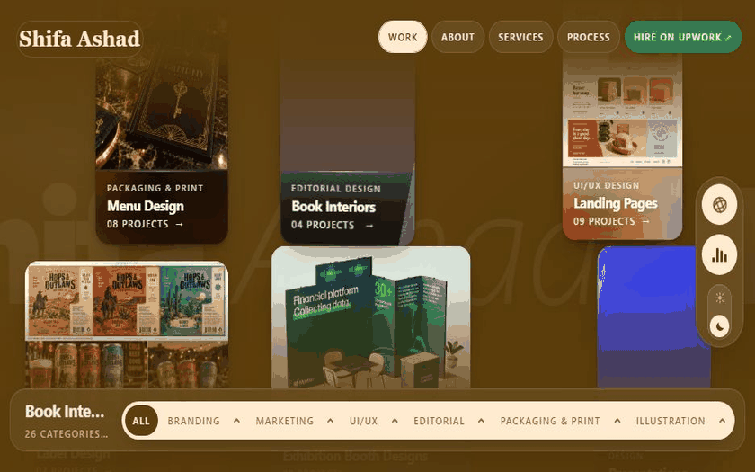

<div align="center">

# SHIFA STUDIOS
### Creative Direction · Brand Identity · UI/UX Design

Live Website: [https://shifastudios.vercel.app/](https://shifastudios.vercel.app/)

<br />

<p align="center">
  
</p>

*An interactive, physics-driven digital showcase featuring 2D inertial field mechanics, real-time dynamic color morphing, integrated studio audio synthesis, and editorial aesthetics.*

</div>

---

## Live Deployment

Production: [https://shifastudios.vercel.app/](https://shifastudios.vercel.app/)  
Upwork: [https://www.upwork.com/freelancers/~014ca0cdb42d3d7d37?companyReference=2069597330411691470&mp_source=share](https://www.upwork.com/freelancers/~014ca0cdb42d3d7d37?companyReference=2069597330411691470&mp_source=share)

---

## Architectural and Design Highlights

### 1. Inertial 2D Physics Canvas
- Continuous mathematical momentum simulation driving project tiles across an unbounded coordinate plane.
- Real-time drag physics, fluid mouse deceleration, scroll-wheel impulse acceleration, and seamless edge wrap-around.
- Dynamic 3D perspective card tilt with eased coordinate mapping calculated via requestAnimationFrame.

### 2. Real-Time Dynamic Palette Adaptation
- Automated CSS custom property interpolation (--paper, --ink, --line).
- As the cursor glides across any showcase card, the entire browser canvas softly morphs its color palette to match the exact chromatic tone of that project.

### 3. Atmospheric Audio and Studio Sound Design
- Cinematic Intro: Deep ambient score mixed with a warm studio voiceover ("Welcome to Shifa Studios.") starting from second zero.
- Continuous Score: Seamless automated crossfade from the intro movement into an ambient background loop (44.1kHz stereo).
- Embedded Architecture: Zero external network requests or 404 delays; audio tracks are embedded directly in the bundle for instant, zero-latency playback.

### 4. Dual Viewport System (Drift vs. Grid)
- Drift Mode: Organic, free-floating physics field for immersive exploration.
- Grid Mode: Structured editorial masonry layout with instant category filtering.

### 5. Fluid Slide-Out Drawers and Brief Builder
- About Sheet: Comprehensive biography, credentials, interactive seal ring, and metrics.
- Services Sheet: In-depth discipline breakdowns and interactive project scope ledgers.
- Process Sheet: Transparent four-phase creative delivery methodology.
- Interactive Brief Builder: Tag-driven project brief synthesizer allowing prospective clients to assemble requirements and copy them in one click.
- Project Detail Modals: High-resolution image inspector featuring one-click copy for project color hex codes.

### 6. Luxury Editorial Typography and Film Texture
- Curated typography featuring Cormorant Garamond, Bricolage Grotesque, Instrument Serif, and JetBrains Mono.
- Procedural SVG fractal noise overlay producing an authentic, tactile matte paper finish.
- Persistent Dark and Light theme engine with localStorage memory and zero flash of unstyled content.

---

## Technology Stack

Designed with a zero-framework, hyper-optimized architecture for maximum performance:

- Core: Semantic HTML5, Vanilla ECMAScript (ES2022+)
- Styling: Modular CSS3, CSS Custom Properties, Fluid clamp typography, GPU-accelerated compositing
- Physics and Motion: Vector calculus momentum engine, requestAnimationFrame render loops
- Audio Synthesis: Native HTML5 Web Audio API and Media Element Pipeline
- Deployment: Vercel Global Edge Network

---

## Quick Start and Local Development

### Prerequisites
- Node.js (version 16 or newer recommended)

### 1. Clone the Repository
```bash
git clone https://github.com/M-isbah234/Shifa_studios.git
cd Shifa_studios
```

### 2. Start the Local Server
```bash
npm start
```
(Or directly run `node server.js` - zero external dependencies needed)

Open [http://localhost:3000](http://localhost:3000) in your browser.

---

## Inquiries and Collaboration

For branding, packaging, creative direction, and digital design engagements:

- Upwork: [Work with Shifa Ashad](https://www.upwork.com/freelancers/~014ca0cdb42d3d7d37?companyReference=2069597330411691470&mp_source=share)
- Portfolio: [https://shifastudios.vercel.app/](https://shifastudios.vercel.app/)

---

<div align="center">
  <sub>(c) 2026 Shifa Studios. All rights reserved.</sub>
</div>
